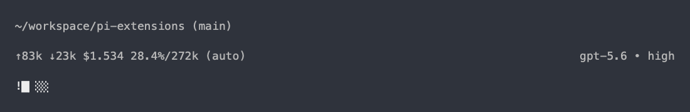

# Pi Context Indicator

Adds a lean four-cell context gauge to Pi’s standard footer status area. Each
full cell represents 25% of the model’s context window, with fractional blocks
showing progress between those points:

```text
▊░░░   (example at 20.4%)
!█░░░  (example at 25.0% — warning)
```

At the conservative 25% workflow checkpoint, an ASCII `!` makes the warning
visible without relying on a particular terminal theme or color palette. The
threshold is advisory, not a universal model-quality boundary.

The extension is independently installable: it uses Pi’s native `setStatus()`
API and shares one status row with other extensions, without replacing the
footer or adding a dedicated line. Only the gauge is published; Pi retains its
built-in context percentage and window display. There is no integration with
other extensions and no change to Pi’s compaction behavior.

Runs only in TUI mode. Unknown or non-finite usage clears the gauge, including
unknown usage after compaction; shutdown clears it too. Plain text stays
readable across theme changes.

Until the standalone package is published, install all extensions from GitHub:

```sh
pi install git:github.com/Smaths/pi-extensions
```

For a local checkout, run `./link-extensions.sh` from the repository root or
install only this extension with `pi install --local ./pi-context-indicator`.

Illustrative preview of the native footer with the context gauge:



Run tests with `node --test index.test.ts` (Node.js with TypeScript stripping).
