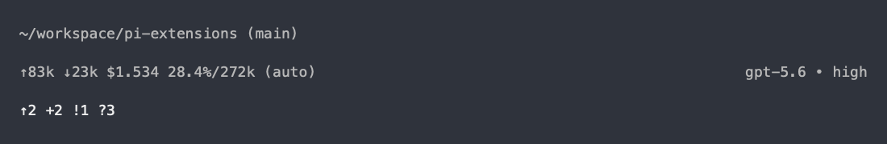

# Pi Git Status

Adds Git state to Pi’s native shared extension-status row using `setStatus()`.
It does not replace the footer: Pi owns the directory, branch, session name,
usage, context, model, and terminal layout. Independently installable; no Herdr
or other extension is required.

```text
↑2 ↓1 +3 !1 ?2 ⚠1
```

Symbols show ahead/behind commits (`↑`/`↓`), staged (`+`), unstaged (`!`),
untracked (`?`), and conflicted (`⚠`) paths. `no-upstream` marks a named branch
without an upstream; `✓` means no changes or divergence to report. Text is
color-independent. Outside a repository, or if Git fails or times out, the
status is hidden.

Refreshes after agent turns and every 10 seconds while in a repository
(60 seconds otherwise). Runs only in TUI mode and clears its status on shutdown.
Other extensions share the same status row; no per-extension line is added.

Version 0.2.0 replaces the previous custom footer with this native status.

Until the standalone package is published, install all extensions from GitHub:

```sh
pi install git:github.com/Smaths/pi-extensions
```

For a local checkout, run `./link-extensions.sh` from the repository root or
install only this extension with `pi install --local ./pi-git-status`.

Illustrative preview of the native footer with Git status:



Run tests with `node --test index.test.ts` (Node.js with TypeScript stripping).
